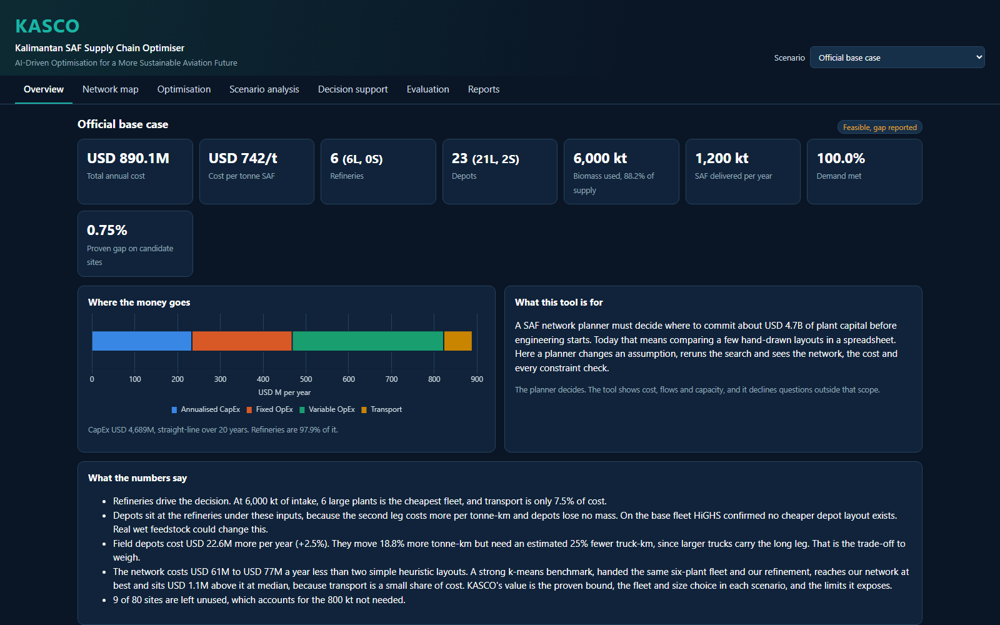

# KASCO: Kalimantan SAF Supply Chain Optimiser

KASCO is a working prototype of a planning tool for a sustainable aviation fuel (SAF) network across Kalimantan. It picks refinery and depot locations and sizes, routes biomass and SAF to the four international airports, and shows the proof behind each number. The solver is written in Rust and compiled to WebAssembly, so the whole product runs in the browser from GitHub Pages with no server. Wee Zhern Ray, a Year 3 chemical engineering student at NUS, built it for Autonomous SG 2026 (Airbus Challenge 3), organised by Acacia Hackathon Society and NUS Product Club. Live app: https://weewzr.github.io/KASCO/



## Who it is for

A SAF network planner who must decide where to commit about USD 4.7B of plant capital before engineering starts. The usual alternative is comparing a few hand-drawn layouts in a spreadsheet. Here the planner changes an assumption, reruns the search and sees the network, the cost and every constraint check. The planner decides. The tool does not claim to replace engineering judgement.

## What is in the app

| Deliverable | Where |
|---|---|
| A. Interactive map | Network map tab: 80 sites, flows by leg, click-through figures, layer toggles, side-by-side comparison |
| B. Optimisation engine | `crates/engine`: Lagrangian branch-and-bound, exact min-cost flow, continuous location refinement |
| C. Scenario simulator | Optimisation and Scenario analysis tabs: every input is editable and reruns the real solver in the browser |
| D. Decision support | Decision support tab: rule-based and fully traceable, with no language model |
| E. Evaluation and evidence | Evaluation and Reports tabs, plus `docs/reports` |

The Decision support tab answers what-if questions that can change several inputs and rerun the solver. It refuses a what-if if any part is unclear, and it declines questions outside the model.

An optional Ask Claude Sonnet 5.5 panel (`docs/assistant.js`) answers free-form questions in short bullets from a snapshot of solver data, opens the matching visual and suggests what to explore next. It uses the viewer's own API key, which stays in tab memory and goes only to api.anthropic.com. Lines with a figure not found in the data are removed.

## Official inputs

The inputs come from the Airbus update of 31 October 2026, 12:45, and `data/challenge3_parameters.xlsx`. `scripts/check_official.py` compares the engine with the workbook and writes `docs/data/official_check.json` (30 checks, all passed in the committed file).

| Input | Small | Large | Units |
|---|---|---|---|
| Depot CapEx | 2.25 | 4.5 | USD M |
| Depot capacity (biomass intake) | 150 | 300 | kt/yr |
| Depot variable OpEx per tonne in | 5 | 4 | USD/t |
| Refinery CapEx | 480 | 765 | USD M |
| Refinery capacity (biomass intake) | 500 | 1,087 | kt/yr |
| Refinery variable OpEx per tonne in | 60 | 55 | USD/t |

| Input | Value | Units |
|---|---|---|
| SAF demand per airport (PNK, PKN, BPN, TRK) | 300 | kt/yr |
| Total SAF demand | 1,200 | kt/yr |
| Biomass available at 80 sites | 6,800 | kt/yr |
| SAF yield | 0.20 | t SAF per t biomass |
| Depot mass retention | 1 | t/t |
| Tariff, biomass site to depot | 0.10 | USD/t/km |
| Tariff, depot to refinery | 0.12 | USD/t/km |
| Tariff, refinery to airport | 0.08 | USD/t/km |
| Road factor on great-circle distance | 1.3 | |
| CapEx life, straight-line, no interest | 20 | yr |
| Fixed OpEx | 5% of CapEx | per yr |

- Demand of 1,200 kt SAF needs 6,000 kt of biomass. Using all 6,800 kt is not required.
- Depots lose no mass, and capacity means biomass intake.
- Costs are on a one-year basis.
- Distance is great-circle x 1.3.
- Tariffs are the same for both truck sizes.
- Tarakan is an island, so its last leg is by barge at USD 0.08/t/km.

Sources of the data files: biomass sites in `data/biomass_sites.csv` and airports in `data/airports.csv`, both from the official challenge data. The parameters are in `docs/data/params.json`.

## Method

1. **Search over refinery sites.** The candidate-site model is a capacitated facility location problem. Relaxing supply and demand with multipliers splits it into one small subproblem per site, which gives a proven lower bound. Branch-and-bound searches the sites, though most of the bound comes from the root relaxation.
2. **Exact flows.** For any set of open refineries, min-cost flow gives the optimal routing.
3. **Continuous refinement.** Sites may be anywhere on land, so plants then move to their weighted geometric median, with a land check.
4. **Independent checks.** `validate.rs` recomputes every balance and the objective from flow records. HiGHS solves the co-located model from an exported LP file as a second opinion.

Depots sit at refineries under these inputs, because the second leg costs more per tonne-km and depots lose no mass. On the base fleet, HiGHS confirmed that no cheaper layout exists with depots free to go anywhere (`scripts/verify_depots.py`). Real wet feedstock could change this, so a field-depot design is included as a priced alternative. It moves more tonne-km but needs an estimated 25% fewer truck-km.

The objective, constraints and the argument for co-located depots are in [docs/MODEL.md](docs/MODEL.md).

## Results

Base case: USD 890.09M per year, USD 742 per tonne SAF before feedstock, six large refineries and 23 depot modules. The best design on candidate sites costs USD 890.32M against a lower bound of USD 883.60M, a proven gap of 0.75%. Continuous location refinement then saves USD 0.23M, which gives the USD 890.09M plan (`docs/data/official_base.json`).

| Result | Status |
|---|---|
| Base case, 70 candidate sites | Feasible within a proven gap |
| Five smaller cases | Rust cost equals the HiGHS proven optimum |
| Refined coordinates | Local refinement, no global proof |
| Field depots | Heuristic, no optimality proof |

The network costs USD 61M to 77M per year less than two simple heuristic layouts. A strong k-means benchmark, handed the same six-plant fleet and our refinement, reaches the same network at best and sits about USD 1.1M above it at median, because transport is only 7.5% of cost. The tool's value is the proven bound, the fleet and size choice in each scenario, and the limits it exposes. These are model results and have not been compared with savings measured against real planners.

The committed results are in `docs/data`. This command reruns every scenario with a 60 s time limit and rewrites the scenario files, `index.json`, `baselines.json`, `ladder.json`, `sensitivity.json` and `network.json`:

```bash
cargo run --release -p saf_cli -- all 60
```

The HiGHS checks write `highs_check.json`, `bound_check.json` and `depot_check.json` in the same folder (see [Run it](#run-it)).

## Limits

- The 80 biomass points are official modelling inputs. None is a surveyed site, and 13 fall off the coastline.
- Site screening is preliminary, so no site is shown to be buildable. Land tenure, peat and forest status are unchecked.
- Official demand is about 12 times our estimate of today's real jet use at these airports, so this is a hub-scale plan.
- The model is deterministic and annual, and biomass purchase price is outside the objective by instruction.

## Front end

The served site in `docs/` is plain HTML, CSS and JavaScript with no bundler. Leaflet draws the maps, Chart.js draws the charts, and the Rust engine runs in a web worker as `saf.wasm`. The November 2026 front-end review added keyboard access, accessible names, evidence labels and input validation, and changed no solver output. Its record, including the Astryx evaluation, the measurements, the tests run and the known limitations, is in [docs/FRONTEND.md](docs/FRONTEND.md). A later polish pass fixed the Side by side table, the phone map legend, the Ask button overlap and the type scale, added a favicon and social tags, Subresource Integrity on the cdnjs files, normal caching of the result JSON and a shared `tokens.core.css`, and added a pull-request workflow (`.github/workflows/ci.yml`: engine tests, official-value check, 64 browser checks) that does not deploy. Details are in the same file.

## Run it

Serve the site locally:

```bash
cd docs && python -m http.server 8765
```

Rebuild from source (needs Rust and the `wasm32-unknown-unknown` target):

```bash
cargo test --release -p saf_engine
cargo run --release -p saf_cli -- all 60
cargo build --release -p saf_wasm --target wasm32-unknown-unknown
cp target/wasm32-unknown-unknown/release/saf_wasm.wasm docs/saf.wasm
```

Cross-checks, which need the Python packages in `requirements-dev.txt`. The second argument of `verify_bound.py` is an existing folder for temporary LP files, and on Windows the binary is `target/release/saf.exe`:

```bash
cargo run --release -p saf_cli -- lp model.lp
```

```bash
python scripts/verify_highs.py model.lp 480
```

```bash
python scripts/verify_bound.py target/release/saf model_folder
```

```bash
python scripts/verify_depots.py 240
```

```bash
python scripts/check_official.py
```

Front-end checks (axe-core, keyboard, labels and a short real solve in a headless browser). They need Node 22 or later, a Chrome or Edge executable and network access. They change no file:

```bash
npm install
npm run check:ui
```

## Repository layout

```text
crates/engine   solver, audit, baselines, diagnostics, decision support, 38 tests
crates/cli      batch runner and LP export
crates/wasm     browser entry points
docs            the deployed site, result JSON and reports
data            official datasets, OSRM road matrix, land mask
scripts         data fetch, HiGHS check, report and deck generators (Python), check_ui.mjs front-end checks
package.json    development-only dependencies for the front-end checks
.github          pull-request workflow (tests and checks only, no deployment)
```

The engine and app are Rust and JavaScript. Python is used only for data fetching, independent checks and document generation.

## Documents

- [docs/MODEL.md](docs/MODEL.md): mathematical model and solution method.
- [docs/FRONTEND.md](docs/FRONTEND.md): front-end review record.
- [docs/SUBMISSION.md](docs/SUBMISSION.md): submission text and the pitch script.
- [docs/reports](docs/reports): the technical report, pitch deck and cover image.

## Sources

Official Airbus problem statement and the update of 31 October 2026. Airports from the official CSV. Land mask from Natural Earth (public domain). Road distances from OpenStreetMap via OSRM, fetched by `scripts/build_data.py`. Real-uplift figures are fetched and recorded by `scripts/fetch_context.py`, with sources in `docs/data/context_check.json`, and appear only in a labelled reality check. Real-world evidence is cited in the Reports tab and the report. Formulation informed by Ng et al. (2018), Ng and Maravelias (2017), Li et al. (2026), Huang et al. (2019), Hernandez-Araujo et al. (2026), Castillo-Villar et al. (2026) and Keyvandarian et al. (2026).

## Licence

MIT. See [LICENSE](LICENSE).
